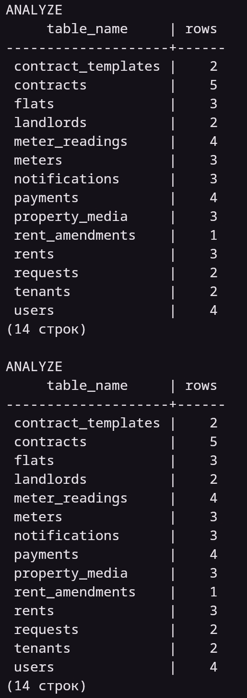

# Отчет по результатам проверки восстановления резервной копии

В ходе проверки восстановления резервной копии базы данных была выполнена команда `ANALYZE` до и после процедуры восстановления, результаты которой отражены на скриншоте. 

Согласно выведенным данным, база данных успешно восстановлена: все 14 таблиц присутствуют в схеме, и по каждой из них зафиксировано идентичное количество строк до и после восстановления — значения полностью совпадают между верхней и нижней выборками. 

Так как статистика строк по всем сущностям одинакова, это подтверждает целостность данных и корректность выполненного резервного копирования, а также успешное восстановление всей структуры и наполнения базы данных без потерь и искажений.