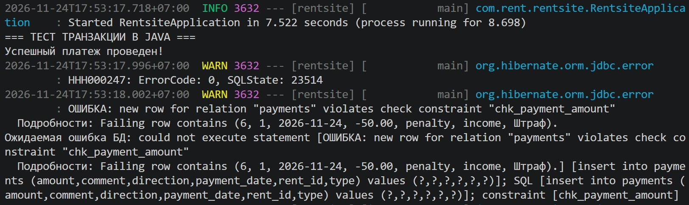
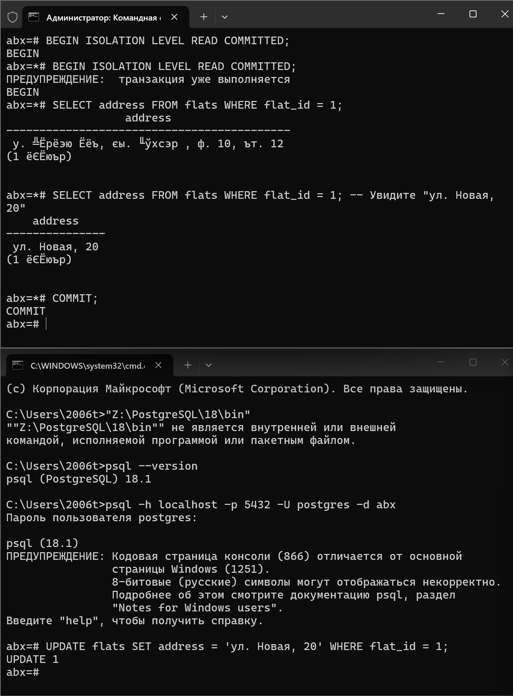
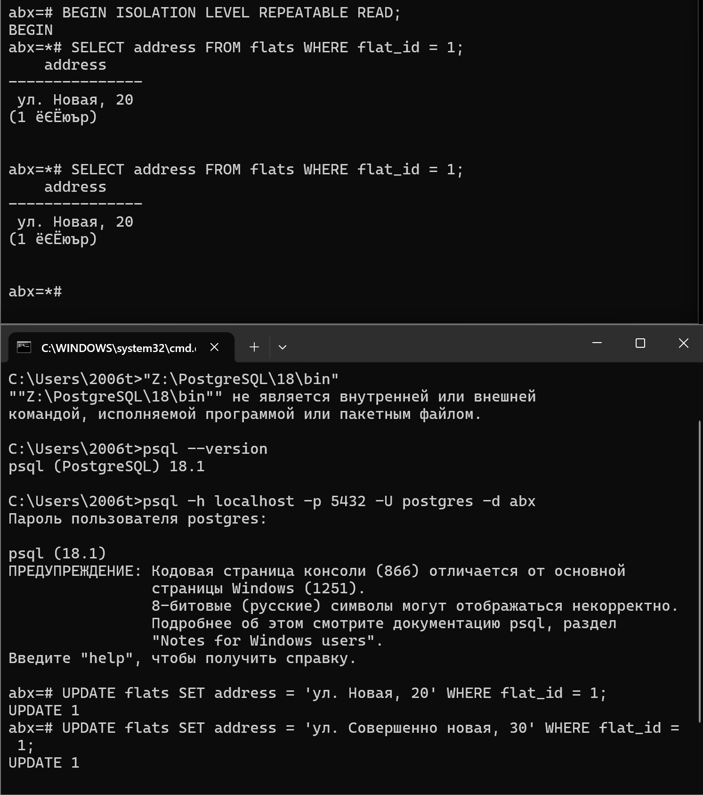

# Отчет по результатам проверки транзакций и уровней изоляций

Была выполнена демонстрация работы механизма транзакций и защиты данных на уровне СУБД: приложение сначала успешно провело валидный платеж (COMMIT), а затем намеренно попыталось вставить некорректную запись, что привело к срабатыванию ограничения и отказу СУБД в выполнении операции (отказ по CHECK). 

В логе зафиксировано перехватываемое Java-приложением исключение, что доказывает корректную работу механизма отката транзакции при ошибке (ROLLBACK):

На последующих рисунках продемонстрировано неповторяющееся чтение в двух параллельных сессиях psql на уровне **Read Committed** и его отсутствие на **Repeatable Read**. 

В первой сессии первый SELECT вернул старое значение, а второй — уже изменённое («ул. Новая, 20»), что подтверждает наличие неповторяющегося чтения:
при уровне **Read Committed** транзакция «фотографирует» данные перед каждым отдельным запросом, поэтому если параллельная сессия успела изменить и сохранить данные между двумя `SELECT`, второй запрос сразу увидит новое значение.

Во второй сессии оба запроса `SELECT` вернули одинаковое исходное значение («ул. Новая, 20»), несмотря на зафиксированное изменение в параллельной транзакции — неповторяющееся чтение отсутствует.
При уровне **Repeatable Read** транзакция «фотографирует» данные один раз — в самом начале, и все последующие запросы внутри неё смотрят на этот же снимок, поэтому даже если параллельная сессия изменила и сохранила данные, ваша транзакция продолжит видеть старые значения до самого завершения